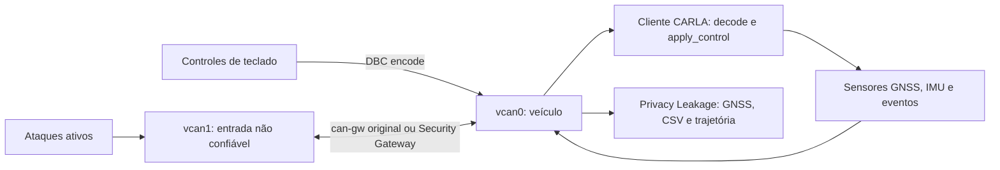

# YES, CARLA CAN — IN1053

## 1. Visão geral

Ambiente experimental de cibersegurança veicular que integra o simulador
**CARLA 0.9.15** a uma rede CAN virtual Linux/SocketCAN. Comandos de teclado
são codificados segundo um DBC, enviados pelo CAN e aplicados ao veículo;
os sensores publicam telemetria no mesmo ambiente.

A infraestrutura original do [YES, CARLA CAN](https://github.com/luigiluz/yes-carla-can)
já incluía controles, sensores, DBC, interfaces virtuais, spoofing de comandos,
fuzzy, DoS e IDS passivo. Esta entrega acrescenta **Replay/Impersonation**,
**Fake Data Fabrication**, **Privacy Leakage** e um **Security Gateway contra
CAN Injection**, além do perfil de performance para as demonstrações.
O spoofing preexistente `hand_brake` é utilizado para avaliar a defesa.

Todo o roteiro usa `vcan0` e `vcan1`, sem barramentos físicos. O projeto mantém
sua [licença MIT](LICENSE).

## 2. Arquitetura



| Componente | Responsabilidade |
|---|---|
| `CARLA_client_module.py`, `gui/`, `sensors/` | Veículo, câmera, aplicação dos controles e telemetria |
| `vehicle_controls_module.py` | Teclado e publicação periódica de comandos |
| `can_network/` | Conexão SocketCAN, codificação/decodificação e validação DBC |
| `data/carla.dbc` | IDs, tamanhos, sinais, escalas e períodos das mensagens |
| `cyberattacks_module.py`, `attacks/` | CLI e implementação dos ataques |
| `security_gateway_module.py`, `defense/` | Inspeção, decisões, encaminhamento e recuperação da ponte |
| `scripts/` | Atalhos de demonstração e relatório dos experimentos |

`vcan0` contém controles, sensores e cliente do veículo; `vcan1` é a entrada
padrão dos ataques ativos. Sem a defesa, a inicialização instala:

```text
cangw -A -s vcan1 -d vcan0 -e
cangw -A -s vcan0 -d vcan1 -e
```

O Privacy Leakage observa `vcan0` por padrão. Com a defesa ativa, as duas rotas
são substituídas temporariamente pela ponte Python. Os controles legítimos
permanecem locais em `vcan0`.

IDs usados nas demonstrações, conforme o DBC original preservado:

| Mensagem | ID | DLC | Período nominal |
|---|---|---:|---|
| THROTTLE | `0x600` | 4 | 100 ms |
| BRAKE | `0x601` | 4 | 100 ms |
| STEER | `0x602` | 4 | 100 ms |
| HAND_BRAKE | `0x604` | 1 | 200 ms |
| GNSS | `0x60E` | 8 | 1.000 ms |

Os callbacks GNSS/IMU podem publicar em taxas diferentes das nominais do DBC.
Usar o DBC padrão mantém produtores, receptores e políticas alinhados. O
argumento `--dbc` do script de inicialização configura os controles; o cliente
CARLA continua usando `data/carla.dbc`.

## 3. Funcionalidades implementadas

### Replay / Impersonation — I5

`attacks/replay_attack.py` captura um CAN ID escolhido, copia payload, DLC,
formato, ordem e tempos relativos e reproduz a sequência depois de uma espera.
A agenda usa relógio monotônico e permite repetições. A captura fica em memória;
o terminal apresenta `[CAPTURE]` e `[REPLAY]`.

O exemplo usa STEER: registrar comandos de esquerda/direita e reproduzi-los
posteriormente. O tráfego legítimo continua existindo e pode disputar o controle
com os quadros reproduzidos.

### Fake Data Fabrication — I1

`attacks/fake_data_fabrication.py` resolve mensagem/sinal no DBC, valida limites
e codifica o valor escolhido com `cantools`. Suporta inicialmente STEER,
THROTTLE e BRAKE e realiza injeção periódica por duração configurada. Diferente
de Replay, cria conteúdo novo sem captura prévia.

### Privacy Leakage — C2

`attacks/privacy_leakage.py` somente recebe GNSS. Decodifica latitude/longitude
pelo DBC, exibe `[LEAK]` e exporta `timestamp,latitude,longitude` para CSV. O
timestamp é relativo ao início da observação e as coordenadas estão em graus.
Com `--plot`, desenha longitude em X e latitude em Y e salva um PNG ao encerrar.
A captura e o desenho usam threads distintas. Não envia quadros nem executa
geocodificação ou recuperação do histórico anterior à captura.

### Security Gateway contra CAN Injection

- **MONITOR:** inspeciona e registra violações, permitindo a passagem.
- **PROTECT:** bloqueia violações e encaminha mensagens autorizadas.
- **Captura passiva:** `MONITOR --passive` observa `vcan0`, sem reenviar nem
  substituir a ponte; usada como referência normal e sem proteção.

A política em [data/can_gateway_policy.json](data/can_gateway_policy.json)
reconhece IDs/formato pelo DBC, valida DLC/tipo de quadro e nega HAND_BRAKE
recebido de `vcan1`. O mesmo comando recebido de `vcan0` é permitido. Cada
segmento admite `allow: "dbc"` ou uma lista de nomes, além de `deny`.

A detecção de frequência usa uma janela por segmento, ID e formato:

```text
limite = ceil(janela / período_DBC × multiplicador) + tolerância de rajada
HAND_BRAKE: ceil(1 s / 0,2 s × 1,5) + 1 = 9 quadros por janela
```

O décimo quadro na janela gera `frequency_exceeded`. O filtro por segmento
já detecta a violação desde o primeiro. Contam-se tentativas bloqueadas;
a fila satura em `limite+1` para limitar memória. Eventos sem período não
recebem limite temporal por padrão. Há `period_overrides_ms` configurável
para períodos medidos. As margens iniciais toleram rajadas e bordas da janela;
não representam uma calibração estatística universal. A política temporal
padrão é aplicada a `vcan1`, preservando o retorno da telemetria de `vcan0`.

O gateway exige interfaces do tipo kernel `vcan`, substitui somente as duas
rotas simples esperadas e recusa duplicatas ou rotas adicionais envolvendo os
segmentos. Não faz flush global. Um socket por segmento, com
`receive_own_messages=False`, evita receber novamente o próprio encaminhamento.
O journal e o lock preservam a recuperação da topologia. A listagem de rotas
é auditada a cada 0,5 s. A compatibilidade com o retorno 36 de `cangw -L` no
can-utils v2023.03 exige saída válida e ausência de stderr.

CAN ID e segmento não autenticam uma ECU. A proteção avaliada é a política
configurada na fronteira, não uma garantia contra todos os ataques. Replay
em taxa compatível pode passar; a leitura passiva de GNSS não é impedida. Um
atacante diretamente em `vcan0` contorna essa fronteira. Não foi reproduzido
o mecanismo físico de dominant-state override descrito por Tindell.

## 4. Requisitos e instalação

- Linux x86_64 com `apt-get` (roteiro Ubuntu/Debian), módulos `vcan` e `can-gw` e
  permissões `sudo` para gerir a rede.
- Sessão gráfica e GPU/driver Vulkan compatíveis com CARLA 0.9.15.
- Conda/Miniconda e Python **3.9**, conforme o instalador existente.
- `can-utils` (`candump`, `cangw`), `iproute2`, `kmod`, `procps`, `curl` e `wget`.
- Pacotes de [requirements.txt](requirements.txt). Entre os utilizados estão
  `carla==0.9.15`, `python-can==4.6.1`, `cantools==40.7.1`, `pygame==2.6.1`,
  `numpy==2.0.2`, `matplotlib==3.9.2`, pandas, joblib, scikit-learn e pytest.

Execute a partir da raiz do repositório:

```bash
./0_install_dependencies.sh
```

O instalador usa `apt-get`, prepara o ambiente `n4s_env`, instala os pacotes e
baixa/extrai o CARLA pelo espelho configurado. Pode instalar Miniconda se
necessário; reinicie o terminal depois de sua inicialização. Quando disponível,
o plugin Conda de termos de uso é utilizado para os canais padrão. Uma
instalação CARLA já existente é preservada.

Configurações opcionais, utilizadas também pelos scripts de execução:

| Variável | Padrão | Finalidade |
|---|---|---|
| `CONDA_ENV_NAME` | `n4s_env` | Ambiente Python |
| `CARLA_FOLDER_NAME` | `carla-0-9-15` | Instalação do simulador, relativa à raiz ou absoluta |
| `DOWNLOAD_FROM_CARLA_GITHUB` | `false` | No instalador, selecionar o download original em vez do espelho |
| `VK_ICD_FILENAMES` | Detectado quando possível | Selecionar o driver Vulkan |

As interfaces virtuais são preparadas por `1_up_environment.sh`; não é
necessário criá-las manualmente. Execute o laboratório no host Linux preparado:
contêineres sem capacidades de rede podem rejeitar SocketCAN e netlink mesmo
com `sudo`. As dependências e o download não foram reinstalados durante a
refatoração; os comandos foram conferidos com o instalador e sua CLI.

## 5. Execução passo a passo

Execute **um experimento por vez**, a partir da raiz. Use um terminal para
iniciar o ambiente, outro para os comandos das demonstrações e, se desejar,
um terceiro para `candump`/logs. Mantenha o CARLA aberto entre cenários.

### Passo 1 — Preparar o ambiente

No terminal das demonstrações:

```bash
export CONDA_ENV_NAME="${CONDA_ENV_NAME:-n4s_env}"
conda activate "$CONDA_ENV_NAME"
PYTHON="$(python -c 'import sys; print(sys.executable)')"
RUN_DIR="results/demo_$(date +%Y%m%d_%H%M%S)"
mkdir -p "$RUN_DIR"
python -c 'import can, cantools, carla, pygame, matplotlib; print("Imports OK")'
```

`PYTHON` guarda o executável do ambiente ativo para os comandos com `sudo`.
As variáveis são locais ao terminal; repita a preparação ou recupere seus
valores ao abrir outro terminal. Use uma pasta nova por sequência e mantenha
essa mesma pasta até concluir. Não sobrescreva as evidências consolidadas.

### Passo 2 — Iniciar o laboratório

No terminal do ambiente:

```bash
./1_up_environment.sh --performance
```

O perfil usa Town02_Opt sem camadas opcionais, janela/câmera 800×450, câmera
limitada a 30 FPS no tempo de simulação e cliente limitado a 60 FPS. O FPS real
depende da máquina. Sem `--performance`, mantém o mapa atual, com 960×540.
`--res`, `--camera-fps`, `--fps`, `--map` e `--minimal-map` permitem ajustes;
`--no-rendering` é para experimentos sem imagens de câmera.

Aguarde as janelas do cliente e dos controles responderem. `Environment is up!`
indica que os processos foram lançados, mas não comprova que a GPU/cliente
iniciou corretamente. Confira, no terminal das demonstrações:

```bash
ip -details link show vcan0
ip -details link show vcan1
sudo cangw -L
candump -n 20 vcan0
```

As interfaces devem ser `vcan`, com flag UP, e as duas regras originais devem
estar presentes. O estado textual UNKNOWN pode ocorrer em interfaces virtuais.
Na janela de controles, W acelera, S freia, A/D viram e SPACE aciona o freio
de mão. Clique nessa janela para que ela receba as teclas.

Se uma execução anterior estiver aberta, pare os ataques e o gateway e
encerre o ambiente antes de reiniciá-lo. O script recusa interfaces já
existentes para evitar duplicar rotas.

### Passo 3 — Executar Replay

```bash
./scripts/demo_replay.sh
```

Durante os 5 s de captura, use A e D para produzir uma sequência de steering.
Depois solte as teclas de direção. Há 3 s de espera e três reproduções; manter
W durante o replay ajuda a observar o efeito. Compare `[CAPTURE]` e `[REPLAY]`.
Para observar apenas esse ID, use em outro terminal:

```bash
candump vcan0,602:7FF
```

A CLI preserva os parâmetros: `--can-id`, `--capture-time`, `--delay`, `--repeat`
e `--vcan`. Por exemplo, `./scripts/demo_replay.sh --repeat 1` faz uma rodada.
Replay/Fabrication escrevem no terminal; para guardar uma tomada, pode-se usar
`./scripts/demo_replay.sh 2>&1 | tee "$RUN_DIR/replay.txt"`.

### Passo 4 — Executar Fake Data Fabrication

```bash
./scripts/demo_fabrication.sh
```

Injeta `STEER_signal=255` a cada 20 ms durante 5 s. Clique na janela de
controles e mantenha W, sem pressionar A/D, para observar a disputa pelo
steering. O terminal registra o valor, o ID e o payload fabricado.

Também é possível escolher outro atuador pelo comando completo:

```bash
python cyberattacks_module.py --feature fabrication \
  --message BRAKE --value 255 --period 0.02 --duration 5 --vcan vcan1
```

Fabrication aceita `--message`, `--signal` ou ambos e exige `--value`. Os
valores são validados pelo DBC; sinais incompatíveis são rejeitados. Os
argumentos adicionais dos atalhos são repassados à CLI.

### Passo 5 — Executar Privacy Leakage

Salve a nova tomada na pasta da execução para preservar a trajetória já entregue:

```bash
./scripts/demo_privacy_leakage.sh --output "$RUN_DIR/privacy_leakage.csv"
```

O script observa por 30 s e abre o gráfico. Volte o foco à janela de controles
e dirija; observe `[LEAK]` e os pontos na trajetória. O fim do tempo, Ctrl+C
ou fechar a janela exportam o CSV e, no modo gráfico, o PNG
`privacy_leakage_route.png` ao lado dele.

```bash
head -n 5 "$RUN_DIR/privacy_leakage.csv"
```

Use `--duration 60` para uma tomada mais longa. Sem sessão gráfica, execute:

```bash
python cyberattacks_module.py --feature privacy_leakage \
  --vcan vcan0 --duration 30 --output "$RUN_DIR/privacy_terminal.csv"
```

Essa última opção não solicita gráfico/PNG. `--plot` exige um backend gráfico
Matplotlib disponível; em uma sessão com Tk instalado, `MPLBACKEND=TkAgg`
pode selecioná-lo. O caminho padrão da CLI é `results/privacy_leakage_trace.csv`:
executar sem um `--output` novo substitui o arquivo anterior.

### Passo 6 — Executar a demonstração da defesa

Os scripts abaixo gerenciam ataque, gateway, captura e restauração. Não inicie
outro encaminhador ou ataque paralelo. Os três cenários de ataque usam o mesmo
spoofing `hand_brake --period 0.02 --vcan vcan1`, encerrado pelo demonstrador.
Cada cenário tem 3 s iniciais, 10 s de ataque/tráfego normal e 3 s finais.

```bash
DEMO_DIR="$RUN_DIR/defense"

sudo "$PYTHON" scripts/demo_can_defense.py normal --output "$DEMO_DIR/normal"
sudo "$PYTHON" scripts/demo_can_defense.py unprotected --output "$DEMO_DIR/unprotected"
sudo "$PYTHON" scripts/demo_can_defense.py monitor --output "$DEMO_DIR/monitor"
sudo "$PYTHON" scripts/demo_can_defense.py protect --output "$DEMO_DIR/protect"
```

Execute as quatro linhas **separadamente**, aguardando cada cenário terminar.
Após READY, clique nos controles e mantenha W nos cenários de ataque, sem
pressionar SPACE. Use condições semelhantes e registre o comportamento que
realmente observar; o script não captura telas nem mede movimento.

| Cenário | Encaminhamento | Resultado esperado |
|---|---|---|
| Normal | Ponte original e observação passiva | Controles e tráfego normal |
| Sem proteção | Ponte original e observação passiva | `604#01` nos dois segmentos |
| MONITOR | Gateway Python | Alertas e passagem de `604#01` |
| PROTECT | Gateway Python | Bloqueio de `604#01` de vcan1; comandos locais continuam |

Cada pasta precisa ser nova. O demonstrador preserva saídas existentes e
retorna erro em vez de sobrescrevê-las. Para repetir, use outro `--output`.

Confira os metadados, bloqueios e a continuidade dos controles:

```bash
cat "$DEMO_DIR/protect/experiment.json"
grep -E -m 5 'BLOCK source=vcan1 ID=0x604' "$DEMO_DIR/protect/gateway.txt"
grep -E -m 5 'frequency_exceeded' "$DEMO_DIR/protect/gateway.txt"
grep -E -m 5 'vcan1 +604#01' "$DEMO_DIR/protect/traffic.log"
grep -E -m 5 'vcan0 +604#01' "$DEMO_DIR/protect/traffic.log"
grep -E -m 5 'vcan0 +604#00' "$DEMO_DIR/protect/traffic.log"
tail -n 3 "$DEMO_DIR/protect/gateway.txt"
sudo cangw -L
```

Em PROTECT, a busca de `vcan0 604#01` deve ficar vazia, desde que SPACE não
tenha sido pressionado. `grep` retorna 1 quando não encontra correspondência;
isso é esperado nessa busca. Confirme também a injeção presente em `vcan1`:
sem ataque, a ausência no destino não comprova bloqueio. `-m 5` mostra até
cinco exemplos, não a contagem total. Em MONITOR, procure `ALLOW` e os mesmos
alertas e confirme `604#01` nos dois segmentos.

Durante READY em MONITOR/PROTECT, `sudo cangw -L` não deve mostrar regras
envolvendo `vcan0`/`vcan1`. Ao terminar, as duas regras originais devem voltar.
Os controles estão em `vcan0`; após a captura, teste também SPACE. Nos CSVs,
a origem representa o segmento de recepção, não uma identidade autenticada.

Cada cenário registra:

- `traffic.log`: captura `candump -L` dos dois segmentos.
- `decisions.csv`: decisão por quadro, origem, ID, payload, motivos e métricas.
- `gateway.txt` / `attack.txt`: saídas dos processos; ataque vazio no normal.
- `experiment.json`: comando, duração e `completed`; o efeito no veículo
  permanece pendente até confirmação humana.

O terminal/log apresenta `analyzed`, `allowed`, `blocked`, `alerts`,
`forwarded` e `send_errors`. No CSV, `forwarded` é por quadro e
`forwarded_total` é acumulado. Um quadro pode ter dois motivos de alerta;
`alerts` conta quadros suspeitos. Erros de envio são registrados e encerram
a ponte, sem provar entrega ao receptor.

Gere as comparações dos quatro cenários e apenas da entrada não confiável:

```bash
sudo "$PYTHON" scripts/can_defense_report.py \
  "$DEMO_DIR/normal" "$DEMO_DIR/unprotected" "$DEMO_DIR/monitor" "$DEMO_DIR/protect" \
  --output "$DEMO_DIR/comparison.png"

sudo "$PYTHON" scripts/can_defense_report.py \
  "$DEMO_DIR/monitor" "$DEMO_DIR/protect" --source vcan1 \
  --output "$DEMO_DIR/comparison_vcan1.png"
```

Cada comando gera também o JSON com as contagens. Não compare a origem
`vcan1` nos cenários passivos: eles observam quadros depois da ponte em `vcan0`.

Para operar o gateway manualmente, execute **um** modo por vez, sem o
orquestrador em paralelo, usando um CSV novo:

```bash
sudo "$PYTHON" security_gateway_module.py --mode MONITOR --log "$RUN_DIR/monitor_manual.csv"
```

Troque por `--mode PROTECT` para proteção. `--policy arquivo.json`, `--dbc`,
`--duration N` e `--state arquivo.json` configuram política, DBC, duração e
journal. Pare o ataque antes de encerrar/trocar o gateway com Ctrl+C.

### Passo 7 — Encerrar e recuperar o laboratório

Depois que os experimentos terminarem, pare os `candump`/acompanhamentos e execute:

```bash
./2_down_environment.sh
```

Se o gateway falhou ou recebeu SIGKILL, pare o atacante e o gateway, mantendo
as interfaces ativas, e recupere **antes** de desligar:

```bash
sudo "$PYTHON" security_gateway_module.py --restore
sudo cangw -L
./2_down_environment.sh
```

Use o mesmo `--state` se escolheu um journal alternativo. A recuperação compara
as regras existentes e adiciona apenas as originais ausentes. Não apague o
journal/lock nem use `cangw -F`. A ponte fica isolada em caso de falha até essa
recuperação explícita. A ativação/desativação tem uma pequena transição entre
segmentos; faça a troca com o ataque parado. O desligamento recusa um journal
padrão pendente para preservar a recuperação.

### Recursos anteriores preservados

A CLI mantém `hand_brake`, `doors`, `reverse`, spoofing de luzes, `fuzzy` e
`denial_of_service`. Use `python cyberattacks_module.py --help` para todas as
opções. `--duration` limita Fabrication/Privacy Leakage; os spoofings, fuzzy e
DoS continuam até serem encerrados. O Replay possui seus próprios tempos.

O IDS original continua passivo, com detectores estatístico e Isolation Forest:

```bash
python intrusion_detection_module.py --detector id_time
python intrusion_detection_module.py --detector ml \
  --ml-model defense/ids_training/models/carla__logs_for_ml_ids_training_parsed__isolation_forest.pkl
```

Coleta, preparação de dados e treinamento também foram mantidos:

```bash
python collect_traffic_logs.py --duration 10 --filename nova_captura.log
python data/candump_csv_parser.py --input traffic_logs/nova_captura.log
python data/can_bus_data_analyzer.py --input traffic_logs/nova_captura_parsed.csv
python defense/ids_training/train.py \
  --csv traffic_logs/logs_for_ml_ids_training_parsed.csv --dbc data/carla.dbc
```

O treinamento exige dados normais; não atribua origem legítima apenas por uma
flag R/T. Esses recursos não são necessários para a política temporal do gateway.

## 6. Resultados experimentais

A sequência real consolidada está em
[results/can_defense_performance/20261014_160808/](results/can_defense_performance/20261014_160808/).
Os CSVs e capturas originais foram preservados.

| Cenário | Quadros de ataque em vcan1 | Quadros correspondentes em vcan0 |
|---|---:|---:|
| Sem proteção | 468 | 468 |
| MONITOR | 471 | 471 |
| PROTECT | 470 | 0 |

MONITOR identificou 471 quadros suspeitos e permitiu seu encaminhamento;
PROTECT bloqueou os 470 recebidos da entrada não confiável. Foram analisadas
2.335 mensagens no normal, 2.761 sem proteção, 2.798 em MONITOR e 2.774 em
PROTECT. Neste último, 2.304 mensagens autorizadas foram encaminhadas e não
houve erros de envio. As contagens diferem entre tomadas; as entradas manuais
não foram rigorosamente idênticas.

[Gráfico dos quatro cenários](results/can_defense_performance/20261014_160808/comparison.png),
[gráfico da entrada vcan1](results/can_defense_performance/20261014_160808/comparison_vcan1.png)
e [registro experimental original](results/can_defense_performance/20261014_160808/observacoes.md)
acompanham os dados. O registro é uma evidência da execução, não um guia
operacional adicional.

Privacy Leakage possui **1.449 posições** registradas em cerca de 60 segundos,
com 646 pares de coordenadas distintos:
[CSV original](results/privacy_leakage_trace.csv) e
[imagem da trajetória](results/privacy_leakage_trace_route.png).
Replay e Fabrication têm implementação, testes e roteiro; não há uma gravação
experimental dedicada que permita apresentar novos resultados quantitativos.

A continuidade dos comandos CAN foi observada nas capturas. A aplicação efetiva
no veículo e parte das verificações visuais permanecem sem confirmação nos
arquivos; `completed: true` confirma a execução do script. Os campos
`vehicle_effect` originais continuam pendentes. Os gráficos representam logs,
não prints do CARLA. A refatoração não executou novamente CARLA, GUI ou SocketCAN
real e não modificou os dados experimentais.

O gateway não oferece autenticação, confidencialidade GNSS ou proteção universal
contra injeção de baixo volume, Replay, Fabrication e DoS. IDs autorizados sob
os limites podem passar. A taxa máxima depende das filas, Python, impressão e
escrita de logs; mudanças administrativas nas rotas também estão fora dessa
garantia. Quadros inválidos permitidos em MONITOR podem afetar o decoder original.

## 7. Testes

Com o ambiente Python ativo, sem CARLA, root ou interfaces CAN:

```bash
python -m pytest tests -q
```

Antes da refatoração: **181 testes aprovados**. Após a refatoração:
**197 testes aprovados**, com um aviso de depreciação de `pkg_resources` no
pygame. Os 16 casos adicionais verificam pré-requisitos, argumentos, rollback
da preparação de rede, ambiente Conda, preservação do CARLA instalado e recusa
do desligamento com recuperação pendente. A suíte cobre DBC, codificação,
os três ataques, configuração de performance, políticas, janela temporal,
transporte virtual, journal/lock e recuperação após falhas parciais.

Os testes usam mocks/stubs de CARLA, relógios determinísticos e python-can
VirtualBus. Não medem FPS real nem substituem a observação do veículo.

Há também uma demonstração offline regenerável, identificada como sintética:

```bash
python scripts/demo_can_defense_virtual.py --output "results/virtual_$(date +%Y%m%d_%H%M%S)"
```

Ela usa o spoofing existente e receptores VirtualBus; não valida can-gw real.
Os resultados sintéticos são gerados sob demanda e identificados como tal.
Para validar scripts sem executá-los:

```bash
for script in ./*.sh scripts/*.sh; do bash -n "$script" || break; done
```

## 8. Estrutura do projeto

```text
yes-carla-can/
├── README.md, LICENSE, requirements.txt
├── 0_install_dependencies.sh
├── 1_up_environment.sh, 2_down_environment.sh
├── CARLA_client_module.py, vehicle_controls_module.py
├── cyberattacks_module.py, security_gateway_module.py
├── intrusion_detection_module.py, collect_traffic_logs.py
├── attacks/       # Replay, Fabrication, Privacy Leakage e ataques anteriores
├── can_network/   # SocketCAN, constantes e validação DBC
├── defense/       # Gateway, topologia e IDS original com modelo/dados de treino
├── data/          # DBC, parser, análise e dados de referência
├── gui/, sensors/, images/
├── scripts/       # Atalhos, quatro cenários, relatório e demonstração virtual
├── tests/
├── traffic_logs/  # Referência do IDS; novas capturas são temporárias
├── results/       # Defesa real consolidada e trajetória GNSS
└── carla-0-9-15/  # Instalação local do simulador, ignorada pelo Git
```
