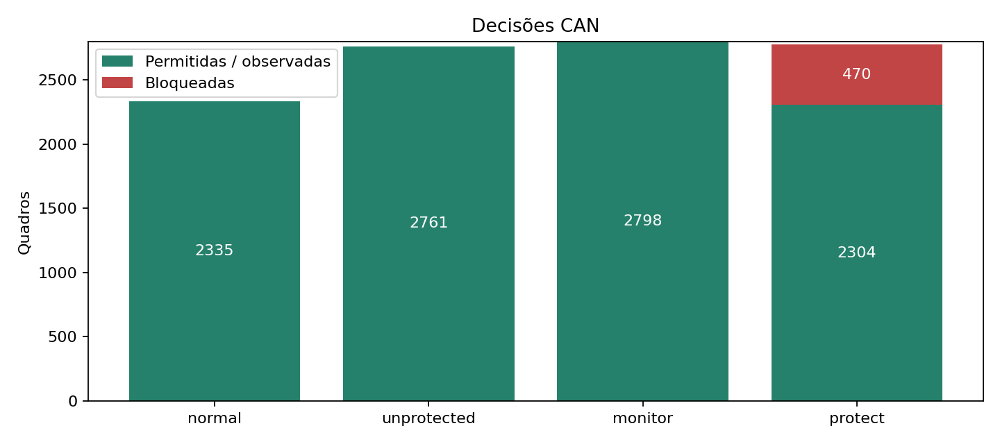
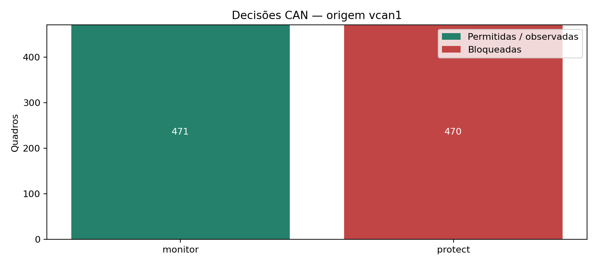

# Observações da demonstração CAN Injection

Relatório preenchido a partir dos arquivos da execução em 14/10/2026. Os
contadores foram recalculados dos CSVs e confrontados com `gateway.txt`,
`traffic.log` e os resumos JSON. Não foram fornecidos registros visuais do
veículo; esses itens estão marcados como **Não verificado**.

## Configuração

- Modo: performance
- Mapa: Town02_Opt
- Resolução: 800x450
- Câmera: limite de 30 FPS
- Segmento do atacante: vcan1
- Segmento do veículo: vcan0
- Ataque: hand_brake, ID 0x604, payload 01
- Período de injeção: 20 ms
- Duração do ataque: 10 segundos

O perfil performance é a configuração adotada no roteiro. Os arquivos de
cenário não registram mapa, resolução ou FPS efetivo; esses parâmetros não
foram confirmados independentemente. A duração acima é a duração configurada
da injeção, não a duração da captura completa.

## Comparação geral dos registros

| Cenário | Analisadas | Permitidas / observadas | Bloqueadas | Quadros com alerta | Enviadas pelo gateway | Erros de envio |
|---|---:|---:|---:|---:|---:|---:|
| Normal | 2.335 | 2.335 | 0 | 0 | 0 | 0 |
| Sem proteção | 2.761 | 2.761 | 0 | 0 | 0 | 0 |
| MONITOR | 2.798 | 2.798 | 0 | 471 | 2.798 | 0 |
| PROTECT | 2.774 | 2.304 | 470 | 470 | 2.304 | 0 |

Nos cenários passivos, `forwarded=0` significa que o observador não envia
quadros; a ponte do kernel continua ativa. Não significa bloqueio.

Contagens de HAND_BRAKE na captura completa de cada experimento:

| Cenário | `vcan1 604#01` | `vcan0 604#01` | `vcan0 604#00` | `vcan1 604#00` |
|---|---:|---:|---:|---:|
| Normal | 0 | 0 | 79 | 79 |
| Sem proteção | 468 | 468 | 79 | 79 |
| MONITOR | 471 | 471 | 79 | 79 |
| PROTECT | 470 | 0 | 79 | 79 |

Isso demonstra passagem observada de 468/468 quadros de ataque sem proteção,
471/471 em MONITOR e 0/470 em PROTECT, neste cenário controlado. ID e payload
isolados não identificam criptograficamente o transmissor.

## Experimento 1 — Tráfego normal

Resultados confirmados nos logs:

- Execução concluída.
- 2.335 mensagens analisadas.
- Nenhum alerta, bloqueio ou erro de envio.
- Capturados 146 quadros de cada ID `0x600`, `0x601` e `0x602` em `vcan0`.
- Acelerador e direção tiveram payloads variáveis. BRAKE permaneceu em
  `00000000` e HAND_BRAKE em `00`; acionamentos de freio e freio de mão não
  foram evidenciados nessa captura.
- Duração observada da captura: aproximadamente 16,532 segundos.

Observação visual:

- Resposta efetiva do veículo a W/A/S/D/SPACE: **Não verificado visualmente**.
- Comportamento e movimento do veículo: **Não verificado**. A atualização dos
  comandos na rede não comprova sua aplicação pelo veículo.

Evidências: [metadados](normal/experiment.json), [decisões](normal/decisions.csv),
[resumo](normal/gateway.txt) e [captura](normal/traffic.log).

## Experimento 2 — Ataque sem proteção

Resultados confirmados nos logs:

- Execução concluída.
- 2.761 mensagens analisadas.
- Nenhum bloqueio ou erro de envio.
- Captura passiva, sem filtragem ativa.
- Capturados 147 quadros de cada ID `0x600`, `0x601` e `0x602` em `vcan0`.
- Duração observada da captura: aproximadamente 16,567 segundos.

Verificações e observação visual:

- Quadros `604#01` encontrados: **468 em `vcan1` e 468 em `vcan0`**.
- Efeito no veículo durante o ataque: **Não verificado visualmente**.
- Recuperação do movimento após o ataque: **Não verificado**.

Evidências: [metadados](unprotected/experiment.json),
[captura](unprotected/traffic.log), [decisões](unprotected/decisions.csv),
[resumo](unprotected/gateway.txt) e [ataque](unprotected/attack.txt).

## Experimento 3 — MONITOR

Resultados confirmados nos logs:

- Execução concluída.
- 2.798 mensagens analisadas e encaminhadas.
- 471 quadros suspeitos geraram alertas.
- Nenhum bloqueio ou erro de envio.
- Alertas de segmento e frequência registrados.
- Quadros 604#01 observados em vcan1 e vcan0.
- Foram recebidos 471 quadros HAND_BRAKE de `vcan1`; todos tiveram
  `source_denied`, decisão `ALLOW` e `forwarded=1`.
- Desses, 462 também tiveram `frequency_exceeded`. Os primeiros nove ainda
  estavam dentro do limite da janela temporal de 1 segundo.
- A captura contém 471 quadros `604#01` em cada segmento.
- Capturados 147 quadros de cada ID `0x600`, `0x601` e `0x602` em `vcan0`.
- Duração observada da captura: aproximadamente 16,574 segundos.

Observação visual:

- Efeito no veículo durante o ataque: **Não verificado visualmente**.
- Recuperação do movimento após o ataque: **Não verificado**.
- Conferência manual das rotas durante READY: **Não verificado**. O processo
  concluiu sem falha nas verificações automáticas de isolamento, mas não há
  captura independente de `cangw -L` durante READY na pasta da execução.

Evidências: [metadados](monitor/experiment.json), [alertas](monitor/gateway.txt),
[decisões](monitor/decisions.csv), [captura](monitor/traffic.log) e
[ataque](monitor/attack.txt).

## Experimento 4 — PROTECT

Resultados confirmados nos logs:

- Execução concluída.
- 2.774 mensagens analisadas.
- 470 quadros suspeitos bloqueados.
- 2.304 mensagens autorizadas encaminhadas.
- Nenhum erro de envio.
- Quadros 604#01 presentes em vcan1.
- A busca por 604#01 em vcan0 não retornou resultados.
- Quadros legítimos 604#00 continuaram em vcan0.
- Todos os 470 HAND_BRAKE de `vcan1` têm `BLOCK`, `source_denied` e
  `forwarded=0`. Desses, 461 também têm `frequency_exceeded`.
- A captura contém 470 quadros `vcan1 604#01`, nenhum `vcan0 604#01` e
  79 quadros `vcan0 604#00`.
- Capturados 148 quadros de cada ID `0x600`, `0x601` e `0x602` em `vcan0`.
- Acelerador e direção apresentaram payloads variáveis. BRAKE permaneceu em
  `00000000`; não foi registrado um comando de frenagem ativo nesse cenário.
- Duração observada da captura: aproximadamente 16,657 segundos.

Observação visual:

- SPACE permaneceu solto durante a captura: **Não verificado diretamente**.
  Não há `604#01` em `vcan0`, mas a captura não registra as teclas físicas.
- Veículo respondeu ao acelerador durante o ataque: **Não verificado visualmente**.
- Direção e freio atuaram efetivamente no veículo: **Não verificado**.
- Houve interferência perceptível do ataque: **Não verificado visualmente**.
- Conferência manual das rotas durante READY: **Não verificado**. O ciclo
  automático concluiu sem erro de isolamento ou restauração, mas não há
  captura independente das rotas durante READY.

Os registros comprovam bloqueio na fronteira virtual e continuidade de
mensagens de controle no segmento confiável. Não comprovam, isoladamente,
que o veículo aplicou os comandos ou se movimentou.

Evidências: [metadados](protect/experiment.json), [bloqueios](protect/gateway.txt),
[decisões](protect/decisions.csv), [captura](protect/traffic.log) e
[ataque](protect/attack.txt).

## Restauração

- As duas regras originais reapareceram após PROTECT, conforme a saída de
  `sudo cangw -L` apresentada pelo usuário na conversa. Não foi localizada uma
  cópia dessa saída em arquivo de texto ou imagem na pasta.
- Funcionamento visual dos controles depois dos experimentos: **Não verificado**.
- Desligamento do CARLA: **Não verificado pelos arquivos desta execução**.

Saída fornecida pelo usuário após PROTECT:

```text
cangw -A -s vcan0 -d vcan1 -e # 983 handled 0 dropped 0 deleted
cangw -A -s vcan1 -d vcan0 -e # 0 handled 0 dropped 983 deleted
```

## Gráficos e capturas de tela

- [comparison.png](comparison.png): gráfico dos quatro cenários, existente.
- [comparison_vcan1.png](comparison_vcan1.png): gráfico da entrada não confiável,
  existente.
- [comparison.json](comparison.json) e [comparison_vcan1.json](comparison_vcan1.json):
  existentes; os contadores conferem com as linhas dos CSVs.
- Prints e vídeos do veículo ou dos terminais: **não encontrados na pasta desta
  execução**. Os gráficos representam os logs, não capturas da tela do CARLA.





## Limitações

- CAN ID não autentica a identidade do transmissor.
- Um atacante diretamente em vcan0 pode contornar esta fronteira.
- O experimento não reproduz dominant-state override físico.
- A conclusão sobre o movimento do veículo depende da observação visual.

## Erros ou diferenças entre os cenários

- Não foram encontrados `SEND_ERROR` nos CSVs; os resumos finais indicam zero
  erros de envio nos quatro cenários.
- O número efetivo de quadros de ataque variou: 468 sem proteção, 471 em MONITOR
  e 470 em PROTECT. Os comandos e durações configurados são iguais, mas a
  quantidade recebida não é idêntica entre execuções.
- As sequências de payloads de acelerador e direção variaram entre cenários.
  Há BRAKE ativo em MONITOR, mas não nas capturas normal, sem proteção e
  PROTECT. Não se afirma que as entradas manuais ou a dinâmica foram idênticas.
- `alerts` conta quadros suspeitos, não a soma dos motivos. A janela satura em
  `limite+1`: `10/9` não é o total de quadros durante a injeção.
- Os quatro `experiment.json` mantêm `vehicle_effect` como
  `PENDING_MANUAL_OBSERVATION`; este relatório não os altera para afirmar
  uma observação visual ausente.

## Conclusão sustentada pelos registros

A injeção observada atravessou a fronteira sem proteção e em MONITOR. O modo
MONITOR detectou violações sem bloquear. Em PROTECT, os 470 quadros HAND_BRAKE
da entrada não confiável foram bloqueados e nenhum `604#01` apareceu em
`vcan0`, enquanto mensagens de controle continuaram presentes nesse segmento.
Os CSVs, capturas e gráficos concordam com esses resultados. A conclusão sobre
movimento, frenagem e resposta efetiva do veículo depende de observação humana
adicional ou de gravação do CARLA.
